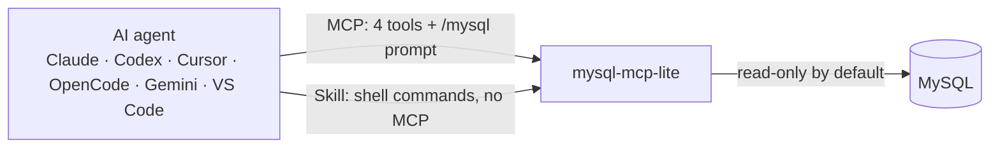

<p align="center">
  
</p>

<h1 align="center">mysql-mcp-lite</h1>

<p align="center">
  <b>MySQL for any AI agent.</b><br>
  An MCP server and an Agent Skill in one small package: browse schemas and run SQL, read-only by default.
</p>

<p align="center">
  <a href="LICENSE"></a>
  
  
  
  
</p>

<p align="center">
  
  
  
  
  
  
  
</p>



## Why

- **Works in any agent.** One install command for every MCP client, plus a skill for agents where MCP isn't allowed.
- **Safe by default.** Read-only, enforced in three layers (see [Safety](#safety)).
- **Light on tokens.** Results come back as compact JSON, capped at 500 rows.

| Tool / command | Does |
|---|---|
| `list_databases` / `databases` | Databases visible to the configured user |
| `list_tables` / `tables` | Tables and views, with approximate row counts |
| `describe_table` / `describe` | `SHOW CREATE TABLE`: columns, indexes, foreign keys |
| `query` / `query` | One SQL statement → `{columns, rows, truncated}` |

Needs [uv](https://docs.astral.sh/uv/) and MySQL 5.7.8+ or 8.x.

## Use it as an MCP server

Every MCP client runs the same command:

```bash
uvx --from git+https://github.com/aniketshukla1/mysql-mcp-lite mysql-mcp-lite
```

The first start downloads dependencies (about 10 seconds). If an agent shows the server as disconnected on its first launch, restart the agent. The examples below use a read-only user `mcp_ro` on database `shop`; swap in your values.

<details>
<summary><b>Claude Code</b></summary>

```bash
claude mcp add -s user mysql -e MYSQL_HOST=127.0.0.1 -e MYSQL_USER=mcp_ro -e MYSQL_PASSWORD=change-me -e MYSQL_DATABASE=shop -- uvx --from git+https://github.com/aniketshukla1/mysql-mcp-lite mysql-mcp-lite
```

</details>

<details>
<summary><b>Codex</b></summary>

```bash
codex mcp add mysql --env MYSQL_HOST=127.0.0.1 --env MYSQL_USER=mcp_ro --env MYSQL_PASSWORD=change-me --env MYSQL_DATABASE=shop -- uvx --from git+https://github.com/aniketshukla1/mysql-mcp-lite mysql-mcp-lite
```

</details>

<details>
<summary><b>Cursor, Gemini CLI, Claude Desktop</b> and most other clients</summary>

They share one JSON shape:

```json
{
  "mcpServers": {
    "mysql": {
      "command": "uvx",
      "args": ["--from", "git+https://github.com/aniketshukla1/mysql-mcp-lite", "mysql-mcp-lite"],
      "env": {
        "MYSQL_HOST": "127.0.0.1",
        "MYSQL_USER": "mcp_ro",
        "MYSQL_PASSWORD": "change-me",
        "MYSQL_DATABASE": "shop"
      }
    }
  }
}
```

| Client | File | Note |
|---|---|---|
| Cursor | `~/.cursor/mcp.json` (all projects) or `.cursor/mcp.json` | `cursor-agent`: approve once with `cursor-agent mcp enable mysql` |
| Gemini CLI | `~/.gemini/settings.json` | Gemini turns MCP servers off in folders you haven't trusted |
| Claude Desktop | `~/Library/Application Support/Claude/claude_desktop_config.json` | If it can't find `uvx`, put the full path from `which uvx` in `command` |

</details>

<details>
<summary><b>OpenCode</b></summary>

In `opencode.json` in the project, or `~/.config/opencode/opencode.json`:

```json
{
  "$schema": "https://opencode.ai/config.json",
  "mcp": {
    "mysql": {
      "type": "local",
      "command": ["uvx", "--from", "git+https://github.com/aniketshukla1/mysql-mcp-lite", "mysql-mcp-lite"],
      "environment": {
        "MYSQL_HOST": "127.0.0.1",
        "MYSQL_USER": "mcp_ro",
        "MYSQL_PASSWORD": "change-me",
        "MYSQL_DATABASE": "shop"
      }
    }
  }
}
```

</details>

<details>
<summary><b>VS Code</b></summary>

In `.vscode/mcp.json`:

```json
{
  "servers": {
    "mysql": {
      "type": "stdio",
      "command": "uvx",
      "args": ["--from", "git+https://github.com/aniketshukla1/mysql-mcp-lite", "mysql-mcp-lite"],
      "env": { "MYSQL_HOST": "127.0.0.1", "MYSQL_USER": "mcp_ro", "MYSQL_PASSWORD": "change-me", "MYSQL_DATABASE": "shop" }
    }
  }
}
```

</details>

Checked: Claude Code, cursor-agent, Gemini CLI and OpenCode connected to the server from these configs, and Codex accepted its config. VS Code and Claude Desktop use their standard formats but weren't run.

### The /mysql prompt

Clients that support MCP prompts show it as a command: `/mcp__mysql__mysql` in Claude Code, `/mcp.mysql.mysql` in VS Code, `/mysql` in Gemini CLI. Give it a question, such as `top 5 customers by revenue last month`; with no question it summarizes the database.

## Use it as a skill (no MCP)

When an agent can't use MCP, the [`mysql` skill](skills/mysql/SKILL.md) teaches it to run the same operations as shell commands. Install it into the agents on your machine:

```bash
npx skills add aniketshukla1/mysql-mcp-lite
```

Or copy [`skills/mysql`](skills/mysql) into your agent's skills folder by hand, for example `~/.claude/skills/mysql` for Claude Code, where it becomes `/mysql`. Checked: with every MCP server turned off, Claude Code answered a question about the test database through this skill alone.

Then give the agent's environment your connection settings, for example in your shell profile:

```bash
export MYSQL_HOST=127.0.0.1 MYSQL_USER=mcp_ro MYSQL_PASSWORD=change-me MYSQL_DATABASE=shop
```

Optional: install the command once so the skill skips the `uvx` download step on each call.

```bash
uv tool install git+https://github.com/aniketshukla1/mysql-mcp-lite
```

## Shell commands

The skill runs these, and you can too:

```bash
mysql-mcp-lite databases
mysql-mcp-lite tables -d shop
mysql-mcp-lite describe orders
mysql-mcp-lite query <<'SQL'
SELECT status, COUNT(*) AS n FROM orders GROUP BY status
SQL
```

```json
{"columns":["status","n"],"rows":[["paid",42],["refunded",3]],"truncated":false}
```

With no command, `mysql-mcp-lite` runs the MCP server on stdio. Errors go to stderr with exit code 1.

## Configuration

| Env var | Default | Meaning |
|---|---|---|
| `MYSQL_HOST` | `127.0.0.1` | |
| `MYSQL_PORT` | `3306` | |
| `MYSQL_USER` | `root` | |
| `MYSQL_PASSWORD` | empty | |
| `MYSQL_DATABASE` | none | Default database for tables, describe and query |
| `MYSQL_ALLOW_WRITE` | off | `true` lets `query` run any statement, committed |
| `MYSQL_MAX_ROWS` | `500` | Rows returned per call; `truncated: true` when cut |
| `MYSQL_TIMEOUT_MS` | `30000` | Per-SELECT limit (`MAX_EXECUTION_TIME`) |

## Safety

Read-only mode stacks three layers:

1. The statement must start with `SELECT`, `SHOW`, `DESCRIBE`, `EXPLAIN`, `WITH`, `TABLE` or `VALUES`, and `INTO OUTFILE/DUMPFILE` is rejected. One statement per call: `SELECT 1; DROP …` fails in MySQL.
2. Every call runs inside `START TRANSACTION READ ONLY` and is rolled back, so DML that slips past layer 1 (such as `WITH … DELETE`) fails in MySQL.
3. **The real boundary: connect as a SELECT-only user.**

```sql
CREATE USER 'mcp_ro'@'%' IDENTIFIED BY 'change-me';
GRANT SELECT, SHOW VIEW ON shop.* TO 'mcp_ro'@'%';
```

## Project layout

```text
src/mysql_mcp_lite/
├── db.py         shared core: connection, read-only guard, compact JSON
├── server.py     MCP server: 4 tools and the /mysql prompt
└── cli.py        the mysql-mcp-lite command: MCP server or shell commands
skills/mysql/     the Agent Skill (no MCP needed)
tests/            end-to-end test against a real MySQL
assets/           logo
```

## Development

Start a throwaway MySQL, then run the end-to-end test:

```bash
docker run -d --name mysql-mcp-test -e MYSQL_ROOT_PASSWORD=testroot -p 127.0.0.1:33306:3306 mysql:8.4
```

```bash
uv run tests/test_e2e.py
```

It starts the MCP server the way an agent does and checks the 4 tools, the `/mysql` prompt, each read-only layer, write mode and truncation, then runs the skill's shell commands.

## License

[MIT](LICENSE)
